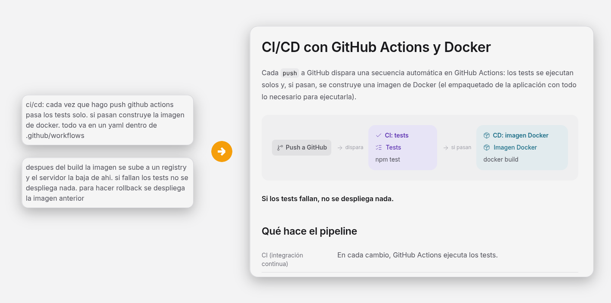
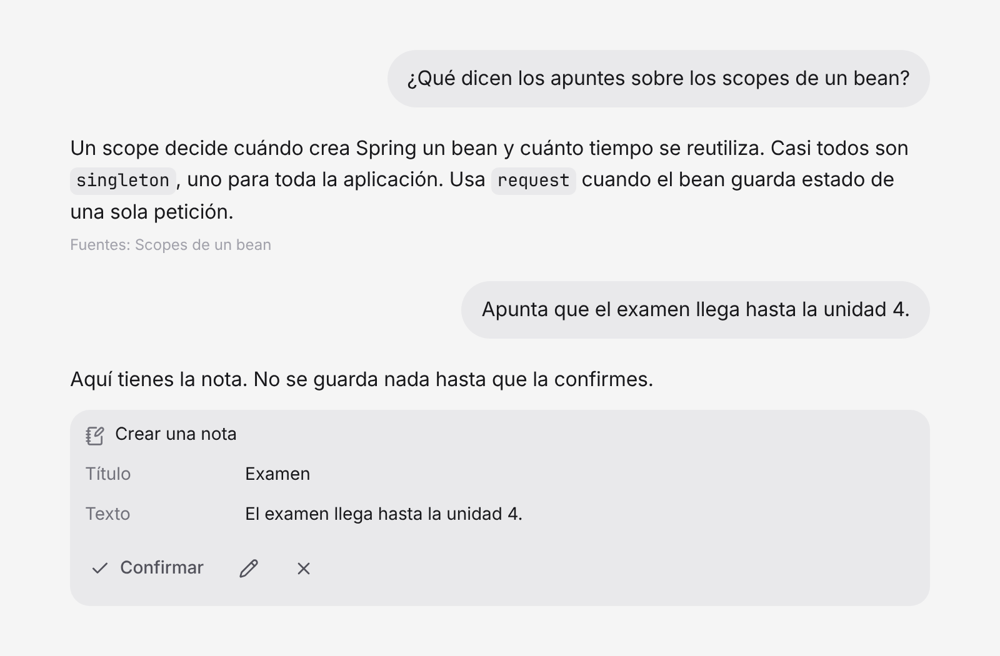

<p align="center">
  
</p>

<h1 align="center">Kolmi</h1>

<p align="center">
  <strong>Kolmi es donde una clase junta sus apuntes. Cada uno deja los suyos y, cada noche, una IA los convierte en páginas compartidas que la clase puede leer y a las que puede preguntar.</strong>
</p>

<p align="center">
  Para una clase, en su propio servidor.
</p>

<p align="center">
  <a href="docs/idea.md"></a>
  <a href="LICENSE"></a>
</p>

<p align="center">
  <a href="#en-local">En local</a> ·
  <a href="README.md">English</a>
</p>

<p align="center">
  
</p>

<p align="center"><sub>Dos notas sueltas entran, una página sale. Es una pasada nocturna real.</sub></p>

## ¿Qué es Kolmi?

Todas las clases acaban igual. Los apuntes están en chats, en carpetas en la nube y en fotos de la
pizarra. Dos personas apuntaron lo mismo de forma distinta, nadie sabe qué versión es la buena, y lo
que necesitas antes del examen está en el cuaderno de otro.

En Kolmi cada uno deja lo que tiene, con sus palabras y sin formato. Cada noche la colmena lee lo
nuevo y juzga cada nota: la junta con lo que la clase ya tiene, quita nombres y datos privados y
descarta lo que no aporta. Lo que queda se convierte en las páginas de la clase, organizadas como
una guía de estudio, con un diagrama donde una idea tiene partes y una tabla o gráfica donde
importan los números. La nota en bruto sigue siendo privada.

Kolmi es para una clase. Cada clase lleva su propia copia, con sus propios datos. Un admin es un
estudiante que cuida de la clase; no hay cuenta de profesor.

## Cómo funciona

Un equipo de agentes trabaja una vez al día, con el horario que fija un admin. El portero lee cada
nota nueva, quita nombres y datos privados, descarta lo que no aporta y decide a qué página va. El
motivo de cada decisión queda en el registro de la IA. El agente de notas escribe lo que el portero
deja pasar, y el agente web lo maqueta como página.

| | Nota en bruto | Página compartida |
|---|---|---|
| Quién la ve | su autor y los admins, hasta que la pasada la recoge | toda la clase |
| Cómo es | texto libre y archivos | organizada, con diagramas, tablas, gráficas y piezas interactivas |
| Nombres y datos privados | lo que hayas escrito | eliminados |

<p align="center">
  
</p>

<p align="center"><sub>Una página puede llevar más que texto: diagramas, código que se copia, pasos numerados. (Esta está en inglés.)</sub></p>

## Pregunta a los apuntes

El chat responde con las páginas de la clase, no con lo que un modelo recuerda. Busca los pasajes
más cercanos a tu pregunta, responde con ellos y dice qué páginas usó. Si pides una tabla o los
pasos de un procedimiento, la dibuja.

<p align="center">
  
</p>

<p align="center"><sub>Una conversación inventada, dibujada con las piezas de la propia app.</sub></p>

El chat puede actuar, pero nunca por su cuenta. Todo lo que cambia algo vuelve como una tarjeta que
enseña qué cambiaría, y ocurre cuando lo confirmas. Un estudiante puede dejar y editar sus notas
así. Un admin además puede mover páginas, editar el horario y cuidar de la gente de la clase.
También puede avisar de un problema de la app. Un admin enciende el chat y fija un límite diario
por estudiante. Más en [docs/chat.md](docs/chat.md) (en inglés).

## Tu propia IA, conectada

Kolmi también es un servidor MCP, así que la IA que ya usas (un agente de programación, un editor)
puede trabajar con los apuntes de la clase en tu nombre. Pongamos que el curso está en Moodle y el
código de las prácticas en un repo de GitHub. Con Moodle, GitHub y Kolmi conectados al mismo
asistente, le pides que lea el material de esta semana y lo pase a limpio. Lee primero el árbol de
la clase, mira lo que ya dicen las páginas y deja una nota por tema, cada una con el enlace de donde
salió. La IA de un admin puede, en cambio, integrar el material directamente en una página.

En Ajustes, en Conecta tu IA, le pones nombre a la conexión y recibes un token, que se muestra una
sola vez, y el comando para tu cliente con la dirección de tu instancia ya puesta. Hay instrucciones
para Claude Code, Gemini CLI y Codex CLI, y para cualquier otro cliente que acepte un token de
portador. Las apps de chat cuyos conectores piden iniciar sesión con OAuth aún no se admiten. Leer
es libre. Tu IA actúa con tu rol, y todo lo que cambia algo te lo pregunta antes. Más en
[docs/mcp.md](docs/mcp.md).

## Alrededor de los apuntes

- Apuntes en directo: durante una clase, alguien comparte lo que escribe y el resto lo sigue según
  aparece. La nota sigue siendo una nota normal y pasa por la pasada nocturna.
- El horario de la clase, que un admin edita arrastrando sobre la cuadrícula.
- Cualquier sección se descarga como archivos Markdown, para guardarla o subirla a NotebookLM. Las
  páginas también pueden llevar archivos para descargar.
- La interfaz es tranquila a propósito: poco texto, iconos que dicen su nombre al pasar el ratón,
  y la app en español o inglés.

## En local

Necesitas Python 3, Node 20 o superior, un proyecto de Supabase y una clave de API de un modelo.

```bash
# backend, en :8000
cd backend
python3 -m venv .venv && source .venv/bin/activate
pip install -r requirements-dev.txt
cp .env.example .env    # Supabase, CLASS_CODE y las claves del modelo
uvicorn app.main:app --reload

# frontend, en :5173
cd frontend
npm install
cp .env.example .env
npm run dev
```

Antes, crea las tablas con [supabase/schema.sql](supabase/schema.sql). Los `.env` se quedan fuera
de git. Cada clase lleva su propia instancia, y el backend se publica como imagen de Docker:
cómo construirla, ejecutarla y programar la pasada está en [backend/README.md](backend/README.md)
(en inglés).

> **Estado: en desarrollo.** La pasada, el chat, el MCP y los apuntes en directo ya están hechos.
> Lo siguiente son un foro y el inicio de sesión con OAuth para las apps de chat. Mira
> [ROADMAP.md](ROADMAP.md) (en inglés).

## Documentación

La documentación está en inglés.

- [La idea](docs/idea.md): el problema, el equipo de agentes y por qué las notas en bruto son privadas.
- [Autenticación y usuarios](docs/authentication.md): cuentas, roles y el código de clase.
- [Funciones y acciones](docs/features.md): qué hace la app y cómo se construye cada acción.
- [El chat](docs/chat.md): qué escribe el modelo, cómo viaja una pregunta y cómo se propone un cambio.
- [Acciones como herramientas](docs/tools.md): cómo una acción sirve a la web, al chat y al MCP.
- [Apuntes en directo](docs/live-notes.md): seguir una clase a través de los apuntes de alguien.
- [Formato de página](docs/page-format.md): cómo llega una página de la pasada a la pantalla.
- [El MCP](docs/mcp.md): conectar tu propia IA, sus tokens, recursos, prompt y evals.
- [Pruebas con casos reales](docs/testing.md): el plan para probarlo antes de que lo use la clase.
- [Datos y privacidad](docs/privacy.md): qué se guarda, quién lo ve y qué sale de la instancia.
- [Tono de marca](docs/brand-tone.md): cómo suena Kolmi.
- [Imágenes de marca](docs/brand-visuals.md): cómo hacer una imagen que parezca de Kolmi.
- [Landing](landing/README.md): la página pública del proyecto. Una clase no la necesita para usar Kolmi.

## Ecosistema

- [elastic-ui](https://github.com/JoseEstevez520/elastic-ui) es la librería de componentes con
  la que está hecha la web.

## Licencia

Kolmi es de código abierto bajo la [licencia MIT](LICENSE). Los problemas de seguridad se
comunican según [SECURITY.md](SECURITY.md), nunca en una issue pública.
