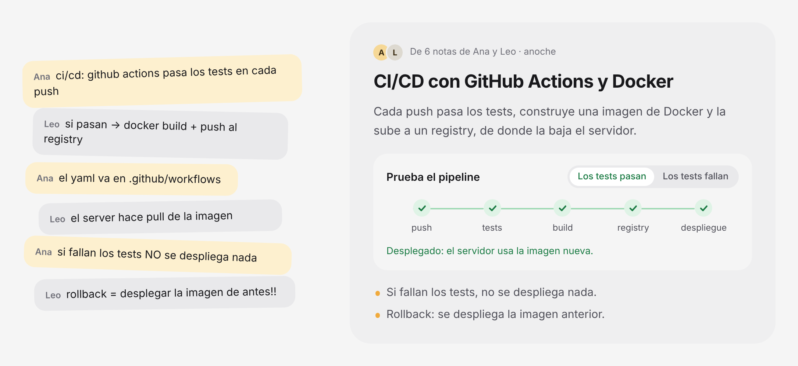
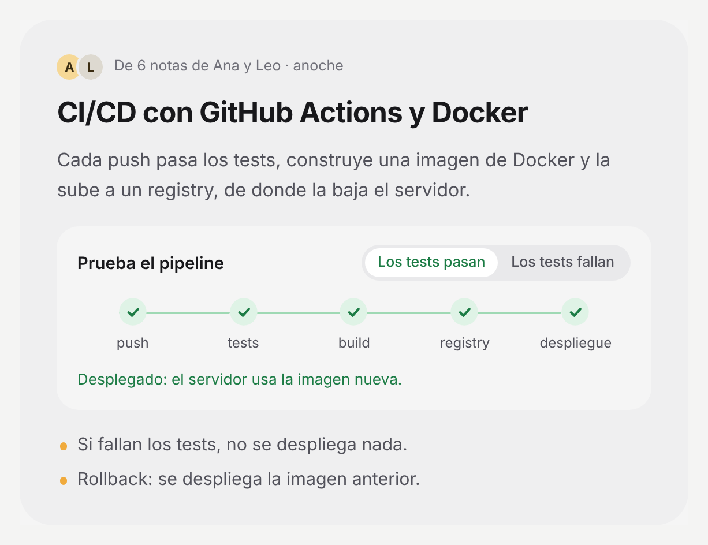
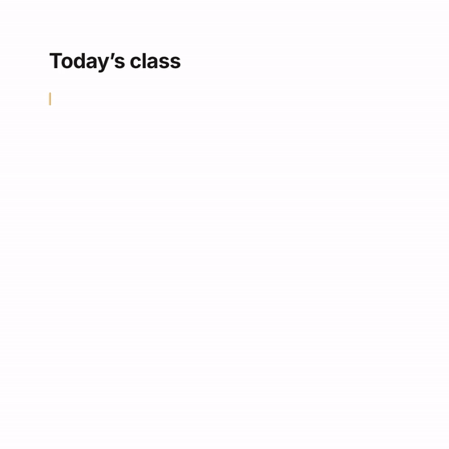
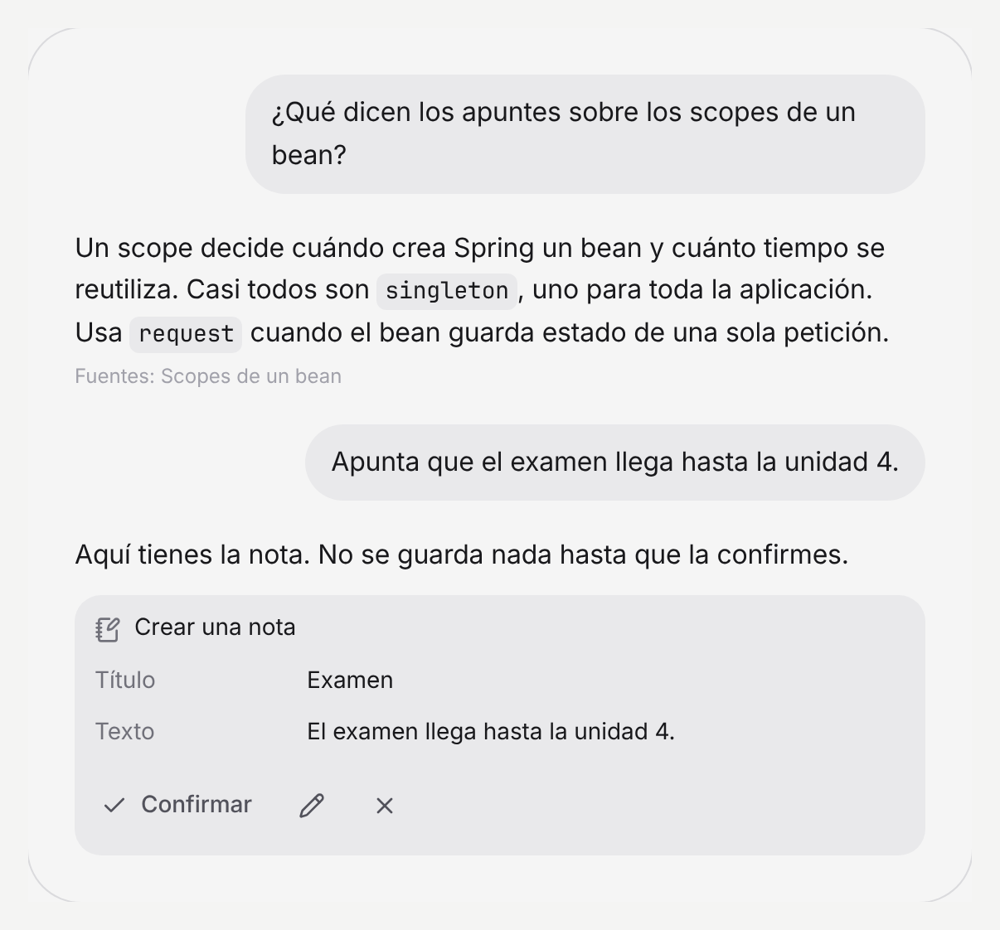

<p align="center">
  
</p>

<h1 align="center">Kolmi</h1>

<p align="center">
  <strong>Apuntes compartidos para una clase. Cada uno deja los suyos; cada noche, una IA los convierte en páginas de estudio que la clase puede leer y consultar.</strong>
</p>

<p align="center">
  Para una clase, en su propio servidor. Aprende en colmena.
</p>

<p align="center">
  <a href="docs/idea.md"></a>
  <a href="LICENSE"></a>
</p>

<p align="center">
  <a href="https://kolmi.es">Web</a> ·
  <a href="#en-local">En local</a> ·
  <a href="README.md">English</a>
</p>

<p align="center">
  
</p>

## Cómo funciona

Cada estudiante deja sus notas con sus palabras: texto suelto, fragmentos de código o archivos. En el horario que fija un admin de la clase, una pasada diaria convierte lo nuevo en las páginas compartidas:

1. **Portero:** lee cada nota pendiente, quita nombres y datos personales, descarta lo que no aporta y decide a qué página va (existente o nueva). Cada decisión queda registrada.
2. **Agente de notas:** integra el material nuevo en el Markdown de la página sin perder lo que ya estaba.
3. **Agente web:** maqueta la página con diagramas, tablas, gráficas, recorridos paso a paso y simuladores interactivos.

| | Nota en bruto | Página compartida |
|---|---|---|
| **Quién la ve** | Solo su autor y los admins | Toda la clase |
| **Formato** | Texto libre, Markdown y archivos adjuntos | Página estructurada con diagramas, tablas, gráficas y piezas interactivas |
| **Datos personales** | Lo que hayas escrito | Eliminados antes de publicar |

<p align="center">
  
</p>

## Qué incluye

### IA dentro de la nota



Pulsa <kbd>Ctrl</kbd> + <kbd>Intro</kbd> en una línea o selección mientras tomas apuntes en clase:

- **Si es una pregunta:** se sustituye en el sitio por apuntes limpios sobre ese tema.
- **Si son tus propios apuntes:** se conservan tal cual y reciben debajo un diagrama, una tabla, pasos o un simulador interactivo.

<br clear="right">

### Chat con los apuntes

El chat responde a partir de las páginas de la clase y cita las fuentes que ha usado. También puede actuar en tu nombre: crear o editar una nota o, si eres admin, gestionar páginas, el horario y los usuarios. Todo cambio se propone primero en una tarjeta y solo se ejecuta cuando lo confirmas. Más en [docs/chat.md](docs/chat.md).

<p align="center">
  
</p>

### Conecta tu propia IA (MCP) y herramientas de clase

| Conecta tu propia IA (MCP) | Para el día a día de la clase |
|---|---|
| Kolmi incluye un servidor MCP. Desde **Ajustes → Conecta tu IA**, genera un token para Claude Code, Gemini CLI, Codex CLI o cualquier cliente compatible.<br><br>Tu asistente puede leer el árbol de la clase, cruzarlo con material externo (como Moodle o GitHub) y dejar notas o actualizar páginas con tu rol. Más en [docs/mcp.md](docs/mcp.md). | • **Apuntes en directo:** comparte lo que escribes durante una clase en tiempo real ([docs/live-notes.md](docs/live-notes.md)).<br>• **Horario:** cuadrícula semanal editable arrastrando los bloques.<br>• **Descargas y exportación:** adjunta archivos a notas y páginas, o descarga cualquier sección en Markdown (para guardarla o subirla a NotebookLM).<br>• **Autohospedado:** una instancia por clase, sin cuenta de profesor, interfaz en español e inglés construida con [elastic-ui](https://github.com/JoseEstevez520/elastic-ui). |

## En local

Necesitas Python 3, Node 20+, un proyecto de Supabase y una clave de API de un modelo compatible con OpenAI.

1. Aplica [supabase/schema.sql](supabase/schema.sql) en tu proyecto de Supabase.
2. Arranca la API y la aplicación web:

```bash
# Backend (:8000)
cd backend
python3 -m venv .venv && source .venv/bin/activate
pip install -r requirements-dev.txt
cp .env.example .env    # Credenciales de Supabase, CLASS_CODE y claves del modelo
uvicorn app.main:app --reload

# Frontend (:5173)
cd frontend
npm install
cp .env.example .env
npm run dev
```

El despliegue con Docker y la programación de la pasada diaria están en [backend/README.md](backend/README.md). El trabajo pendiente está en [ROADMAP.md](ROADMAP.md).

## Documentación

La documentación detallada está en inglés:

| Tema | Documento |
|---|---|
| Idea y agentes | [docs/idea.md](docs/idea.md), [docs/page-format.md](docs/page-format.md) |
| Funciones, acciones y herramientas | [docs/features.md](docs/features.md), [docs/tools.md](docs/tools.md), [docs/chat.md](docs/chat.md), [docs/live-notes.md](docs/live-notes.md) |
| Servidor MCP | [docs/mcp.md](docs/mcp.md) |
| Autenticación, privacidad y pruebas | [docs/authentication.md](docs/authentication.md), [docs/privacy.md](docs/privacy.md), [docs/testing.md](docs/testing.md) |
| Marca y landing pública | [docs/brand-tone.md](docs/brand-tone.md), [docs/brand-visuals.md](docs/brand-visuals.md), [landing/README.md](landing/README.md) |

## Licencia

Código abierto bajo la [licencia MIT](LICENSE). Los problemas de seguridad se comunican según [SECURITY.md](SECURITY.md).
