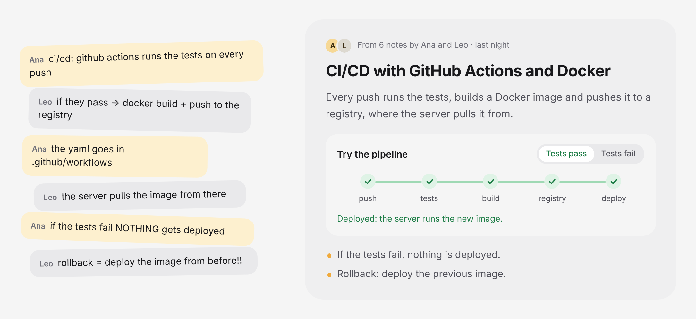
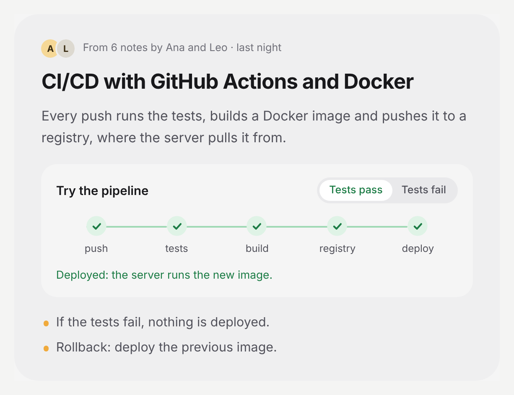
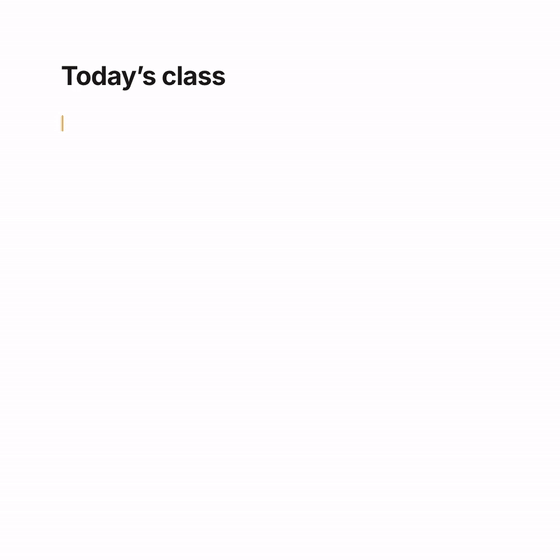
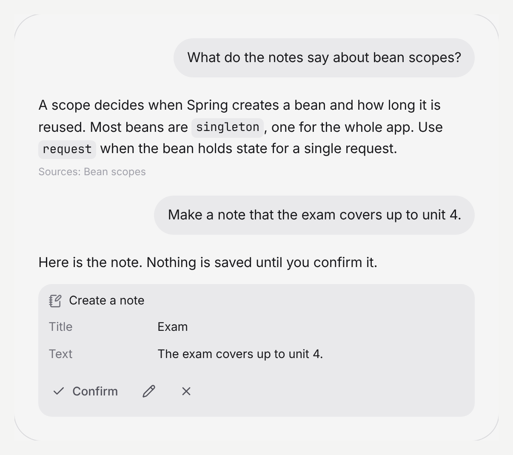

<p align="center">
  
</p>

<h1 align="center">Kolmi</h1>

<p align="center">
  <strong>Shared notes for a class. Everyone leaves theirs; every night, an AI turns them into study pages the class can read and ask questions of.</strong>
</p>

<p align="center">
  For one class, self-hosted. Learn as a hive.
</p>

<p align="center">
  <a href="docs/idea.md"></a>
  <a href="LICENSE"></a>
</p>

<p align="center">
  <a href="https://kolmi.es">Website</a> ·
  <a href="#run-it-locally">Run locally</a> ·
  <a href="README.es.md">Español</a>
</p>

<p align="center">
  
</p>

## How it works

Students drop notes in their own words: rough text, code snippets, or files. On the schedule set by a class admin, a daily pass turns new notes into the class's shared pages:

1. **Gatekeeper:** reads each pending note, strips names and personal data, discards what adds nothing, and routes the rest to an existing or new page. Every decision is logged.
2. **Notes agent:** folds the new material into the page's Markdown without losing what was already there.
3. **Web agent:** lays out the page with diagrams, tables, charts, step-by-step walkthroughs, and interactive simulators.

| | Raw note | Shared page |
|---|---|---|
| **Visibility** | Author and class admins only | The whole class |
| **Format** | Free text, Markdown, and attached files | Structured page with diagrams, tables, charts, and interactive pieces |
| **Personal data** | Whatever the author wrote | Stripped before publishing |

<p align="center">
  
</p>

## Features

### Write with the AI in a note



Press <kbd>Ctrl</kbd> + <kbd>Enter</kbd> on a line or selection while taking notes in class:

- **Ask a question:** replaced in place with clean notes on that topic.
- **Select your own notes:** kept as written, with a diagram, table, step-by-step flow, or interactive simulator drawn underneath.

<br clear="right">

### Ask the notes

The chat answers from the class's pages and cites the sources it used. It can also act for you: creating or editing a note, or, for admins, managing pages, the timetable, and users. Every change is proposed as a card first and only runs when you confirm. See [docs/chat.md](docs/chat.md).

<p align="center">
  
</p>

### Connect your own AI (MCP) & class tools

| Connect your own AI (MCP) | Built for the class |
|---|---|
| Kolmi includes an MCP server. From **Settings → Connect your AI**, generate a bearer token for Claude Code, Gemini CLI, Codex CLI, or any MCP client.<br><br>Your assistant can read the class tree, cross-reference external material (such as Moodle or GitHub), and leave notes or update pages using your role. See [docs/mcp.md](docs/mcp.md). | • **Live notes:** stream what you write during a lecture in real time ([docs/live-notes.md](docs/live-notes.md)).<br>• **Timetable:** weekly class schedule edited by dragging slots on the grid.<br>• **Downloads & export:** attach files to notes and pages, or export any section as Markdown (for local archives or NotebookLM).<br>• **Self-hosted:** one instance per class, no teacher account, English and Spanish UI built with [elastic-ui](https://github.com/JoseEstevez520/elastic-ui). |

## Run it locally

Requires Python 3, Node 20+, a Supabase project, and an OpenAI-compatible model API key.

1. Apply [supabase/schema.sql](supabase/schema.sql) to your Supabase project.
2. Start the API and the web app:

```bash
# Backend (:8000)
cd backend
python3 -m venv .venv && source .venv/bin/activate
pip install -r requirements-dev.txt
cp .env.example .env    # Supabase credentials, CLASS_CODE, and model keys
uvicorn app.main:app --reload

# Frontend (:5173)
cd frontend
npm install
cp .env.example .env
npm run dev
```

Docker deployment and the cron setup for the daily pass are covered in [backend/README.md](backend/README.md). Planned work is tracked in [ROADMAP.md](ROADMAP.md).

## Documentation

| Topic | Document |
|---|---|
| Core concept & agents | [docs/idea.md](docs/idea.md), [docs/page-format.md](docs/page-format.md) |
| Features, actions & tools | [docs/features.md](docs/features.md), [docs/tools.md](docs/tools.md), [docs/chat.md](docs/chat.md), [docs/live-notes.md](docs/live-notes.md) |
| MCP server | [docs/mcp.md](docs/mcp.md) |
| Auth, privacy & testing | [docs/authentication.md](docs/authentication.md), [docs/privacy.md](docs/privacy.md), [docs/testing.md](docs/testing.md) |
| Brand & public landing | [docs/brand-tone.md](docs/brand-tone.md), [docs/brand-visuals.md](docs/brand-visuals.md), [landing/README.md](landing/README.md) |

## License

Open source under the [MIT license](LICENSE). Report security issues following [SECURITY.md](SECURITY.md).
