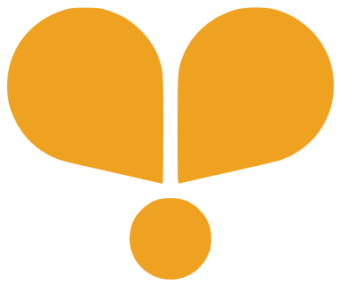
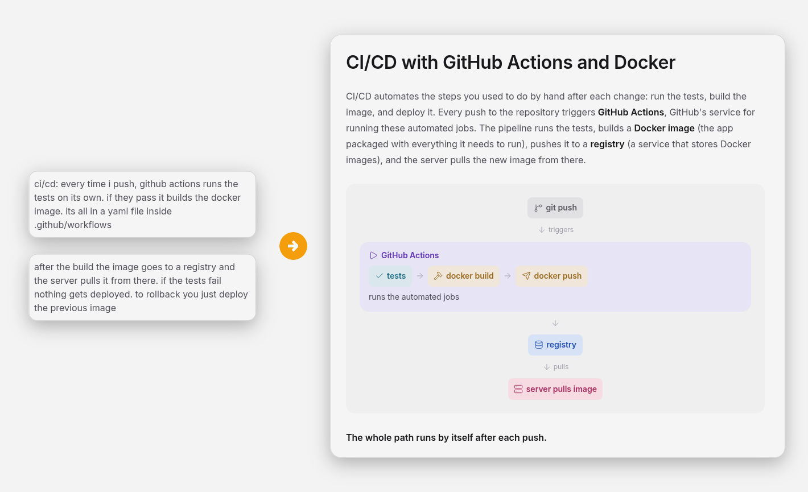
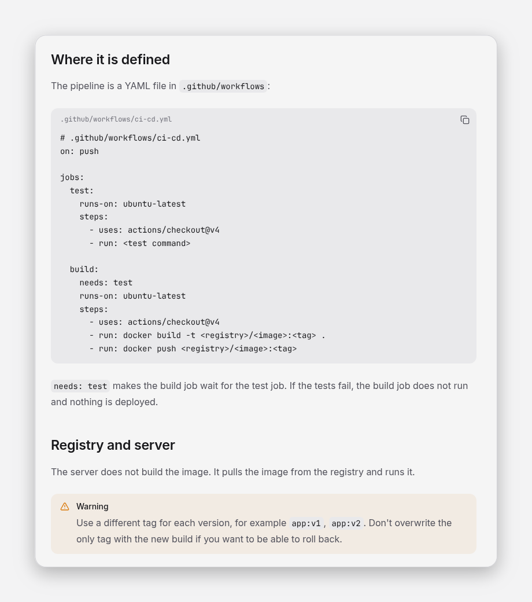
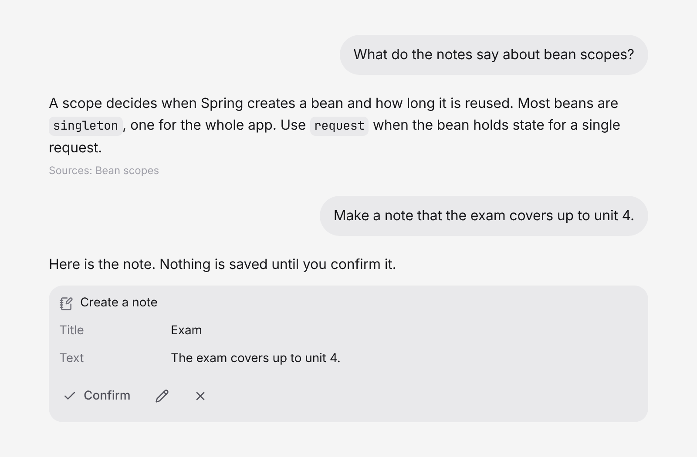

<p align="center">
  
</p>

<h1 align="center">Kolmi</h1>

<p align="center">
  <strong>Kolmi is where a class keeps its notes together. Everyone leaves theirs, and every night an AI turns them into shared pages the class can read and ask questions of.</strong>
</p>

<p align="center">
  For one class, self-hosted.
</p>

<p align="center">
  <a href="docs/idea.md"></a>
  <a href="LICENSE"></a>
</p>

<p align="center">
  <a href="#run-it-locally">Run locally</a> ·
  <a href="README.es.md">Español</a>
</p>

<p align="center">
  
</p>

<p align="center"><sub>Two loose notes in, one page out. This one is a real run of the nightly pass.</sub></p>

## What is Kolmi?

Every class ends up with the same mess. The notes sit in chats, personal drives and photos of the
whiteboard. Two people wrote the same thing down differently, nobody knows which version is
right, and what you need before the exam is in someone else's notebook.

In Kolmi everyone leaves what they have, in their own words and in no particular format. Each
night the hive reads what is new and judges every note: it joins it with what the class already
has, strips names and private data and drops what adds nothing. What is left becomes the class's
pages, laid out like a study guide, with a diagram where an idea has parts and a table or chart
where the numbers matter. The raw note stays private.

Kolmi is for one class. Each class runs its own copy, with its own data. An admin is a student
who looks after the class; there is no teacher account.

## How it works

A team of agents runs once a day, on the schedule an admin sets. The gatekeeper reads each new
note, strips names and private data, discards what adds nothing and decides which page it belongs
to. The reason for each decision is kept in the AI log. The notes agent writes what the
gatekeeper lets through, and the web agent lays it out as a page.

| | Raw note | Shared page |
|---|---|---|
| Who sees it | its author and the admins, until the pass takes it | the whole class |
| What it looks like | free text and files | organized, with diagrams, tables, charts and interactive pieces |
| Names and private data | whatever you wrote | stripped |

<p align="center">
  
</p>

<p align="center"><sub>A page can hold more than text: diagrams, code you can copy, numbered steps.</sub></p>

## Ask the notes

The chat answers from the class's own pages, not from what a model remembers. It finds the
passages closest to your question, answers with them and says which pages it used. Ask for a table
or the steps of a procedure and it draws one.

<p align="center">
  
</p>

<p align="center"><sub>A made-up conversation, drawn with the app's own parts.</sub></p>

The chat can act, but never on its own. Anything that changes something comes back as a card
showing what would change, and it happens when you confirm. A student can leave and edit their own
notes this way. An admin can also move pages, edit the timetable and look after the class's
people. It can report a problem with the app too. An admin turns the chat on and sets a daily
limit per student. See [docs/chat.md](docs/chat.md).

## Your own AI, connected

Kolmi is also an MCP server, so the AI you already use (a coding agent, an editor) can work with
the class's notes as you. Say your course is on Moodle and the practice code is in a GitHub repo.
With Moodle, GitHub and Kolmi connected to the same assistant, you ask it to read this week's
material and write it up. It reads the class's tree first, sees what the pages already say and
leaves one note per topic, each with the link it came from. An admin's AI can fold the material
straight into a page instead.

In Settings, under Connect your AI, you name the connection and get a token, shown once, and the
command for your client with your instance's address already in it. There are instructions for
Claude Code, Gemini CLI and Codex CLI, and for any other client that takes a bearer token. Chat
apps whose connectors need an OAuth sign-in are not supported yet. Reading is free. Your AI acts
with your role, and anything that changes something asks you first. See
[docs/mcp.md](docs/mcp.md).

## Around the notes

- Live notes: during a class, someone shares what they are writing and the rest follow it as it
  appears. The note stays an ordinary note and goes through the nightly pass.
- The class timetable, which an admin edits by dragging on the grid.
- Any section downloads as Markdown files, to keep or to upload to NotebookLM. Pages can carry
  files to download too.
- The interface is quiet on purpose: little text, icons that say their name on hover, and the app
  in English or Spanish.

## Run it locally

You need Python 3, Node 20 or higher, a Supabase project and an API key for a model.

```bash
# backend, on :8000
cd backend
python3 -m venv .venv && source .venv/bin/activate
pip install -r requirements-dev.txt
cp .env.example .env    # Supabase, CLASS_CODE and the model keys
uvicorn app.main:app --reload

# frontend, on :5173
cd frontend
npm install
cp .env.example .env
npm run dev
```

Create the tables first with [supabase/schema.sql](supabase/schema.sql). The `.env` files stay
out of git. Each class runs its own instance, and the backend ships as a Docker image: build, run
and the cron for the pass are in [backend/README.md](backend/README.md).

> **Status: in development.** The pass, the chat, the MCP and live notes are built. A forum and
> the OAuth sign-in for chat apps come next. See [ROADMAP.md](ROADMAP.md).

## Documentation

- [The idea](docs/idea.md): the problem, the team of agents and why raw notes stay private.
- [Authentication and users](docs/authentication.md): accounts, roles and the class code.
- [Features and actions](docs/features.md): what the app does and how each action is built.
- [The chat](docs/chat.md): what the model writes, how a question travels and how a change is proposed.
- [Actions as tools](docs/tools.md): how one action serves the web, the chat and the MCP.
- [Live notes](docs/live-notes.md): following a class through someone's notes.
- [Page format](docs/page-format.md): how a page goes from the pass to the screen.
- [The MCP](docs/mcp.md): connecting your own AI, its tokens, resources, prompt and evals.
- [Testing with real cases](docs/testing.md): the plan for trying it before the class does.
- [Data and privacy](docs/privacy.md): what is stored, who sees it and what leaves the instance.
- [Brand tone](docs/brand-tone.md): how Kolmi sounds.
- [Brand visuals](docs/brand-visuals.md): how to make an image that looks like Kolmi.
- [Landing](landing/README.md): the project's public page. A class doesn't need it to run Kolmi.

## Ecosystem

- [elastic-ui](https://github.com/JoseEstevez520/elastic-ui) is the component library the web
  is built with.

## License

Kolmi is open source under the [MIT license](LICENSE). Security issues should follow
[SECURITY.md](SECURITY.md), never a public issue.
